# ChemiAccel Design Document

## Overview

ChemiAccel is designed as a next-generation computational science platform that transforms the entire discovery cycle in chemical and material sciences. The architecture employs a modular, cloud-native design that seamlessly scales from local development to massive distributed computing environments, integrating high-performance compute kernels with AI-driven discovery engines and comprehensive workflow orchestration.

The platform provides multiple specialized backends and deployment modes:
- **CUDA Backend**: Optimized for NVIDIA GPUs with custom C++/CUDA kernels and RAPIDS integration
- **JAX Backend**: Designed for TPUs and diverse accelerators with JIT compilation and automatic differentiation
- **Cloud-Native Mode**: Serverless deployment on AWS/Google/Azure with auto-scaling
- **HPC Integration**: Multi-node distributed computing with MPI and SLURM support
- **Inference Server**: High-throughput REST API for real-time predictions

## Architecture

### High-Level Platform Architecture

```mermaid
graph TB
    subgraph "User Interface Layer"
        A[Python API] --> B[Calculator Class]
        A --> C[REST API Server]
        A --> D[Cloud CLI Tools]
        A --> E[HPC Job Scripts]
    end
    
    subgraph "Core Engine Layer"
        B --> F[Backend Selector]
        C --> F
        D --> F
        E --> F
        F --> G[CUDA Backend]
        F --> H[JAX Backend]
        F --> I[CPU Fallback]
    end
    
    subgraph "AI & Discovery Layer"
        J[Active Learning] --> F
        K[Inverse Design] --> F
        L[Generative Chemistry] --> F
        M[Multi-Objective Optimization] --> F
        N[Uncertainty Quantification] --> F
    end
    
    subgraph "Specialized Modules"
        O[Polymer Engine] --> F
        P[Materials Science] --> F
        Q[Pharmacophore Screening] --> F
        R[Reaction Informatics] --> F
        S[MD Trajectory Analysis] --> F
        T[GIST Solvation] --> F
    end
    
    subgraph "Cloud & Distributed Layer"
        U[AWS Batch] --> F
        V[Google Cloud Batch] --> F
        W[Azure Batch] --> F
        X[SLURM/MPI] --> F
        Y[Dask/Ray Clusters] --> F
    end
    
    subgraph "Data & Storage Layer"
        Z[Cloud Storage S3/GCS] --> F
        AA[HPC File Systems] --> F
        BB[Data Curation Pipeline] --> F
        CC[Federated Learning] --> F
    end
```



### Cloud-Native Architecture

#### Serverless Batch Processing

```python
class CloudBatchProcessor:
    """Orchestrate serverless batch jobs across cloud providers."""
    
    def __init__(self, provider: str = 'aws'):
        """Initialize cloud batch processor."""
        self.provider = provider
        self.batch_client = self._initialize_batch_client()
    
    def package_for_deployment(self, code_path: str) -> str:
        """Package ChemiAccel into container for batch deployment."""
        
    def submit_job(self, job_definition: dict, input_uri: str, 
                   output_uri: str) -> str:
        """Submit batch job with auto-scaling GPU nodes."""
        
    def monitor_job(self, job_id: str) -> dict:
        """Monitor job progress and resource utilization."""
        
    def stream_from_storage(self, uri: str) -> Iterator[pd.DataFrame]:
        """Stream molecular data directly from cloud storage."""

class MLPlatformIntegration:
    """Native integration with cloud ML platforms."""
    
    def create_sagemaker_processor(self, instance_type: str = 'ml.p3.2xlarge'):
        """Create SageMaker Processing Job configuration."""
        
    def create_vertex_custom_job(self, machine_type: str = 'n1-standard-4'):
        """Create Vertex AI Custom Job configuration."""
        
    def create_azure_batch_job(self, vm_size: str = 'Standard_NC6'):
        """Create Azure Batch job configuration."""
```

#### HPC and Distributed Computing

```python
class HPCIntegration:
    """Integration with high-performance computing environments."""
    
    def __init__(self):
        """Initialize HPC integration with MPI detection."""
        self.mpi_world_size = self._detect_mpi_world_size()
        self.mpi_rank = self._detect_mpi_rank()
    
    def distribute_workload(self, molecules: pd.Series) -> pd.Series:
        """Distribute molecular dataset across MPI ranks."""
        
    def parallel_io_strategy(self, file_system: str = 'lustre'):
        """Implement efficient parallel I/O for HPC file systems."""
        
    def generate_slurm_script(self, nodes: int, gpus_per_node: int) -> str:
        """Generate SLURM submission script for multi-node jobs."""

class DaskRayIntegration:
    """Integration with Dask and Ray for distributed computing."""
    
    def __init__(self, framework: str = 'dask'):
        """Initialize distributed computing framework."""
        
    def create_dask_cluster(self, scheduler_address: str):
        """Connect to existing Dask cluster."""
        
    def distribute_on_dask_cudf(self, ddf: dask_cudf.DataFrame) -> dask_cudf.DataFrame:
        """Execute ChemiAccel on Dask-cuDF partitions."""
        
    def ray_remote_calculator(self, molecules: pd.Series) -> ray.ObjectRef:
        """Ray remote function for distributed calculation."""
```

### Backend Selection Strategy

The system implements intelligent backend and deployment selection:

1. **Hardware Detection**: Probe for NVIDIA GPUs, TPUs, and other accelerators
2. **Environment Detection**: Detect cloud, HPC, or local environments
3. **Performance Profiling**: Quick benchmark to determine optimal configuration
4. **Deployment Strategy**: Choose between local, cloud batch, or distributed execution
5. **Fallback Strategy**: Graceful degradation across deployment modes
6. **Manual Override**: Allow explicit backend and deployment selection

### Future Development Phases

#### Phase 22-25: Autonomous AI-Lab Integration & Advanced Technologies

Based on the expanded requirements and task list, ChemiAccel will incorporate cutting-edge autonomous laboratory integration and quantum machine learning capabilities:

```python
class AutonomousLabIntegration:
    """Deep DMTA cycle automation with robotic platform integration."""
    
    def generate_synthesis_instructions(self, molecules: List[str]) -> List[dict]:
        """Generate machine-readable synthesis instructions for robotic platforms."""
        pass
        
    def ingest_experimental_data(self, data_stream: Iterator[dict]) -> pd.DataFrame:
        """Ingest real-time experimental results from automated equipment."""
        pass
        
    def trigger_adaptive_retraining(self, new_data: pd.DataFrame):
        """Automatically retrain models with new experimental data."""
        pass

class QuantumMLIntegration:
    """High-throughput quantum machine learning for electronic properties."""
    
    def predict_qml_properties(self, molecules: pd.Series, properties: List[str]) -> pd.DataFrame:
        """Predict quantum-derived properties using GPU-accelerated QML models."""
        # HOMO-LUMO gap, atomic partial charges, reaction energies
        # Integration with ANI, GFN2-xTB surrogates
        pass
        
    def gradient_based_qml_optimization(self, target_properties: dict) -> List[str]:
        """Optimize molecules based on QML properties using automatic differentiation."""
        pass

class IntelligentKnowledgeGraph:
    """AI-powered chemical knowledge graph for contextual insights."""
    
    def construct_knowledge_graph(self, data_sources: List[str]) -> nx.Graph:
        """Build knowledge graph from structured and unstructured chemical data."""
        pass
        
    def semantic_query_interface(self, query: str) -> List[dict]:
        """Natural language querying of chemical knowledge."""
        pass
        
    def contextual_recommendations(self, molecules: List[str]) -> List[dict]:
        """Provide contextualized recommendations based on knowledge graph."""
        pass

class MaterialsDigitalTwin:
    """Real-time multi-scale material digital twin."""
    
    def construct_digital_twin(self, material_definition: dict) -> dict:
        """Create multi-scale digital twin combining atomistic to bulk models."""
        pass
        
    def simulate_real_time_response(self, stimuli: dict) -> dict:
        """Simulate material response to environmental conditions in real-time."""
        pass
        
    def inverse_design_with_twin(self, target_properties: dict) -> List[str]:
        """Use digital twin feedback for inverse material design."""
        pass
```

#### Phase 26-30: Next-Generation Capabilities

The platform will extend into revolutionary new areas:

```python
class PredictiveMaterialLifecycle:
    """Comprehensive material lifecycle and sustainability analysis."""
    
    def predict_degradation_pathways(self, materials: List[str], conditions: dict) -> pd.DataFrame:
        """Predict long-term degradation mechanisms using multi-scale models."""
        pass
        
    def assess_recyclability(self, materials: List[str]) -> pd.DataFrame:
        """Predict recyclability and circular economy potential."""
        pass
        
    def lifecycle_assessment_integration(self, materials: List[str]) -> pd.DataFrame:
        """Integrate with LCA databases for environmental impact assessment."""
        pass

class SelfAssemblyDesign:
    """AI-driven self-assembly and complex system design."""
    
    def predict_self_assembly(self, building_blocks: List[str]) -> dict:
        """Predict self-assembly behavior using GPU-accelerated coarse-grained simulations."""
        pass
        
    def inverse_design_emergent_properties(self, target_structure: dict) -> List[str]:
        """Design molecular building blocks for desired emergent properties."""
        pass

class AISpectroscopyIntegration:
    """Automated structure elucidation from spectroscopic data."""
    
    def predict_spectra(self, molecules: List[str], spectrum_types: List[str]) -> dict:
        """Predict NMR, IR, MS, UV-Vis spectra using QML models."""
        pass
        
    def inverse_structure_elucidation(self, experimental_spectra: dict) -> List[str]:
        """Propose chemical structures from experimental spectroscopic data."""
        pass

class ExplainableAI:
    """Universal explainable AI for molecular and material predictions."""
    
    def molecular_feature_attribution(self, predictions: pd.DataFrame) -> dict:
        """Identify molecular substructures contributing to predictions."""
        pass
        
    def gnn_explanations(self, model: Any, molecules: List[str]) -> dict:
        """Explain GNN predictions using attention mechanisms and saliency maps."""
        pass
        
    def interactive_explanation_visualization(self, explanations: dict) -> plotly.Figure:
        """Create interactive visualizations of AI explanations."""
        pass
```

## Components and Interfaces

### Core API Interface

```python
class Calculator:
    def __init__(self, backend='auto', device=None, batch_size='auto', 
                 cloud_config=None, distributed_config=None):
        """Initialize ChemiAccel calculator with backend and deployment selection."""
        
    def pandas(self, molecules: pd.Series) -> pd.DataFrame:
        """Calculate descriptors returning pandas DataFrame."""
        
    def cudf(self, molecules: cudf.Series) -> cudf.DataFrame:
        """Calculate descriptors with GPU-native cudf integration."""
        
    def jax(self, molecules: List[str]) -> jax.Array:
        """Calculate descriptors returning JAX arrays."""
        
    def configure_descriptors(self, descriptor_set: Union[str, List[str]]):
        """Configure which descriptors to calculate."""
        
    def curate(self, dataset: Union[pd.Series, cudf.Series]) -> cudf.DataFrame:
        """GPU-accelerated data curation and canonicalization pipeline."""

class CloudCalculator(Calculator):
    """Cloud-native calculator for serverless batch processing."""
    
    def submit_batch_job(self, data_uri: str, output_uri: str, 
                        cloud_provider: str = 'aws') -> str:
        """Submit batch processing job to cloud provider."""
        
    def stream_from_cloud(self, data_uri: str) -> Iterator[pd.DataFrame]:
        """Stream molecular data directly from cloud storage."""

class FederatedCalculator(Calculator):
    """Secure calculator for federated learning scenarios."""
    
    def calculate_local_features(self, molecules: pd.Series) -> np.ndarray:
        """Calculate features locally without data leaving environment."""
        
    def compute_gradients(self, model_updates: dict) -> dict:
        """Compute gradients for federated learning."""

class InferenceServer:
    """High-throughput REST API server for real-time predictions."""
    
    def start_server(self, host: str = "0.0.0.0", port: int = 8000):
        """Start persistent inference server."""
        
    def preload_models(self, model_configs: List[dict]):
        """Preload models to eliminate cold-start latency."""
```

### AI-Driven Discovery Interfaces

```python
class ActiveLearningLoop:
    """Intelligent molecule selection for experimental validation."""
    
    def __init__(self, calculator: Calculator, acquisition_function: str = 'uncertainty'):
        """Initialize active learning with ChemiAccel backend."""
        
    def select_candidates(self, search_space: pd.Series, n_candidates: int = 50) -> pd.DataFrame:
        """Select most informative molecules for next iteration."""
        
    def update_model(self, new_data: pd.DataFrame):
        """Update predictive model with new experimental results."""

class InverseDesign:
    """Gradient-based molecular optimization in latent space."""
    
    def __init__(self, calculator: Calculator, target_properties: dict):
        """Initialize inverse design with property targets."""
        
    def optimize_molecules(self, starting_molecules: List[str], 
                          n_iterations: int = 100) -> List[str]:
        """Generate optimized molecules using automatic differentiation."""
        
    def apply_constraints(self, sa_threshold: float = 3.0, 
                         drug_like: bool = True):
        """Apply synthetic accessibility and drug-likeness constraints."""

class GenerativeChemistry:
    """Advanced molecular generation with multiple architectures."""
    
    def __init__(self, model_type: str = 'graph_vae', 
                 pretrained_checkpoint: str = None):
        """Initialize generative model."""
        
    def generate_scaffold_variations(self, scaffold: str, n_molecules: int = 10000) -> List[str]:
        """Generate variations keeping core scaffold intact."""
        
    def fine_tune_for_properties(self, target_profile: dict, 
                                training_data: pd.DataFrame):
        """Fine-tune generator for specific property profile."""
        
    def closed_loop_optimization(self, docking_engine: str = 'vina'):
        """Integrate with docking for closed-loop optimization."""

class MultiObjectiveOptimizer:
    """Navigate multi-dimensional property trade-offs."""
    
    def __init__(self, objectives: List[dict]):
        """Initialize with objective functions and targets."""
        
    def find_pareto_front(self, molecules: pd.Series) -> pd.DataFrame:
        """Identify non-dominated solutions on Pareto front."""
        
    def visualize_tradeoffs(self, results: pd.DataFrame) -> plotly.Figure:
        """Interactive visualization of objective trade-offs."""

class UncertaintyQuantification:
    """Estimate prediction uncertainty for informed decision-making."""
    
    def __init__(self, method: str = 'deep_ensemble'):
        """Initialize UQ method (deep_ensemble, mc_dropout, conformal)."""
        
    def predict_with_uncertainty(self, molecules: pd.Series) -> pd.DataFrame:
        """Return predictions with uncertainty bounds."""
        
    def calibrate_uncertainty(self, validation_data: pd.DataFrame):
        """Calibrate uncertainty estimates on validation set."""
```

### Data Curation and Quality Control

```python
class DataCurationPipeline:
    """GPU-accelerated molecular data cleaning and standardization."""
    
    def __init__(self, calculator: Calculator):
        """Initialize with ChemiAccel backend."""
        self.calculator = calculator
        
    def curate_dataset(self, molecules: pd.Series) -> cudf.DataFrame:
        """Execute full curation pipeline on GPU."""
        # SMILES validation and sanitization
        # Salt stripping and neutralization
        # Tautomer standardization
        # InChIKey generation for deduplication
        # PAINS filtering
        pass
        
    def parallel_validation(self, molecules: pd.Series) -> pd.DataFrame:
        """Parallel molecular validation with error reporting."""
        pass
        
    def tautomer_standardization(self, molecules: pd.Series) -> pd.Series:
        """Standardize tautomers for consistent representation."""
        pass

class InferenceServer:
    """High-performance REST API server for real-time predictions."""
    
    def __init__(self, calculator: Calculator):
        """Initialize with preloaded models."""
        self.calculator = calculator
        self.models = {}
        
    def start_server(self, host: str = "0.0.0.0", port: int = 8000):
        """Start persistent inference server with dynamic batching."""
        pass
        
    def preload_models(self, model_configs: List[dict]):
        """Preload models to eliminate cold-start latency."""
        pass
        
    def handle_batch_prediction(self, molecules: List[str]) -> dict:
        """Process batch predictions with optimal GPU utilization."""
        pass

class FederatedLearning:
    """Privacy-preserving federated learning capabilities."""
    
    def __init__(self, calculator: Calculator):
        """Initialize federated learning client."""
        self.calculator = calculator
        
    def calculate_local_features(self, molecules: pd.Series) -> np.ndarray:
        """Calculate features locally without data leaving environment."""
        pass
        
    def compute_gradients(self, model_updates: dict) -> dict:
        """Compute gradients for federated learning."""
        pass
        
    def ensure_privacy_preservation(self) -> bool:
        """Validate that no molecular data leaves the environment."""
        pass

### Specialized Domain Modules

```python
class PolymerEngine:
    """Comprehensive polymer science toolkit."""
    
    def __init__(self, calculator: Calculator):
        """Initialize with ChemiAccel backend."""
        
    def predict_tg(self, monomers: pd.Series) -> pd.DataFrame:
        """Predict glass transition temperature from monomer structure."""
        
    def predict_youngs_modulus(self, monomers: pd.Series) -> pd.DataFrame:
        """Predict mechanical properties from monomer structure."""
        
    def simulate_copolymer_properties(self, monomer_a: str, monomer_b: str, 
                                    ratio: float, copolymer_type: str) -> dict:
        """Predict copolymer properties from constituent monomers."""
        
    def inverse_polymer_design(self, target_properties: dict) -> List[str]:
        """Generate novel monomers optimized for target polymer properties."""
        
    def simulate_thermoset_curing(self, resin: str, hardener: str, 
                                stoichiometry: float) -> dict:
        """Monte Carlo simulation of thermoset curing process."""

class MaterialsScience:
    """Crystalline and periodic material analysis."""
    
    def __init__(self, calculator: Calculator):
        """Initialize materials science module."""
        
    def featurize_crystals(self, cif_files: List[str]) -> cudf.DataFrame:
        """Calculate descriptors for crystalline materials from CIF files."""
        
    def calculate_void_fraction(self, structures: List[pymatgen.Structure]) -> np.ndarray:
        """Calculate void fraction for porous materials."""
        
    def predict_gas_uptake(self, mofs: pd.DataFrame, gas: str = 'CO2') -> pd.DataFrame:
        """Predict gas uptake capacity for MOFs."""

class PharmacophoreScreening:
    """3D pharmacophore modeling and virtual screening."""
    
    def __init__(self, calculator: Calculator):
        """Initialize pharmacophore screening module."""
        
    def define_pharmacophore(self, features: List[dict]) -> Pharmacophore:
        """Define 3D pharmacophore model from feature coordinates."""
        
    def screen_library(self, molecules: pd.Series, 
                      pharmacophore: Pharmacophore) -> pd.DataFrame:
        """Screen molecular library against pharmacophore hypothesis."""
        
    def generate_conformers_gpu(self, molecules: pd.Series, 
                               n_conformers: int = 100) -> List[np.ndarray]:
        """GPU-accelerated conformer generation."""

class ReactionInformatics:
    """High-throughput reaction enumeration and analysis."""
    
    def __init__(self, calculator: Calculator):
        """Initialize reaction informatics module."""
        
    def enumerate_reactions(self, reactants: List[str], 
                           templates: List[str]) -> pd.DataFrame:
        """Parallel reaction enumeration with GPU acceleration."""
        
    def calculate_reaction_fingerprints(self, reactions: pd.DataFrame) -> np.ndarray:
        """Generate fingerprints representing reaction transformations."""
        
    def score_synthetic_feasibility(self, products: pd.Series) -> np.ndarray:
        """Integrate with retrosynthesis models for feasibility scoring."""

class MDTrajectoryAnalysis:
    """High-throughput molecular dynamics trajectory analysis."""
    
    def __init__(self, calculator: Calculator):
        """Initialize MD analysis module."""
        
    def analyze_dynamics(self, trajectory_files: List[str]) -> pd.DataFrame:
        """Compute time-series properties from MD trajectories."""
        
    def find_allosteric_pathways(self, trajectory: str) -> nx.Graph:
        """Identify allosteric communication pathways."""
        
    def generate_dynamic_plifs(self, protein_ligand_traj: str) -> np.ndarray:
        """Generate dynamic Protein-Ligand Interaction Fingerprints."""

class GISTSolvation:
    """GPU-accelerated solvation thermodynamics analysis."""
    
    def __init__(self, calculator: Calculator):
        """Initialize GIST analysis module."""
        
    def analyze_hydration(self, trajectory: str, 
                         analysis_region: np.ndarray) -> dict:
        """Perform GIST analysis on protein-water trajectory."""
        
    def find_hotspots(self, gist_data: dict) -> pd.DataFrame:
        """Identify favorable and unfavorable hydration sites."""
        
    def integrate_with_pharmacophore(self, hotspots: pd.DataFrame) -> List[dict]:
        """Convert hydration hotspots to pharmacophore features."""

class AdvancedDescriptorEngine:
    """Comprehensive descriptor calculation including advanced 3D and drug discovery features."""
    
    def __init__(self, calculator: Calculator):
        """Initialize advanced descriptor engine."""
        self.calculator = calculator
        
    def calculate_3d_descriptors(self, molecules: pd.Series, conformers: List[np.ndarray]) -> pd.DataFrame:
        """Calculate comprehensive 3D descriptors from conformer ensembles."""
        # Radius of gyration, PMI ratios, asphericity
        # Surface area, volume, shape-based descriptors
        # Electrostatic descriptors with partial charges
        pass
        
    def calculate_admet_descriptors(self, molecules: pd.Series) -> pd.DataFrame:
        """Calculate ADMET and drug discovery descriptors."""
        # Absorption, Distribution, Metabolism, Excretion, Toxicity
        # Drug-likeness scores (QED, CNS-MPO, BBB-MPO)
        # Synthetic accessibility scoring
        pass
        
    def calculate_constitutional_descriptors(self, molecules: pd.Series) -> pd.DataFrame:
        """Calculate 150+ constitutional and topological descriptors."""
        # Atom and bond counting variants
        # Constitutional indices and complexity metrics
        # Information content descriptors
        pass
        
    def calculate_gnn_features(self, molecules: pd.Series) -> pd.DataFrame:
        """Calculate graph neural network features for molecular graphs."""
        # Node and edge feature extraction
        # Graph embeddings and fingerprints
        # Hierarchical graph pooling operations
        pass

class TrajectoryAnalysisEngine:
    """High-throughput molecular dynamics trajectory analysis."""
    
    def __init__(self, calculator: Calculator):
        """Initialize trajectory analysis engine."""
        self.calculator = calculator
        
    def analyze_dynamic_networks(self, trajectory: str) -> List[nx.Graph]:
        """Analyze dynamic network evolution in MD trajectories."""
        pass
        
    def generate_dynamic_plifs(self, protein_ligand_traj: str) -> np.ndarray:
        """Generate dynamic Protein-Ligand Interaction Fingerprints."""
        pass
        
    def calculate_timeseries_properties(self, trajectory: str) -> Dict[str, np.ndarray]:
        """Calculate time-series molecular properties from trajectories."""
        pass
        
    def parallel_trajectory_processing(self, trajectory_files: List[str]) -> pd.DataFrame:
        """Process multiple trajectories in parallel on GPU cluster."""
        pass
```

### CUDA Backend Components

#### Molecular Representation Engine

**Tensor-Based Molecular Storage**:
- **Atom Feature Matrix**: `(num_atoms, num_features)` tensor containing atomic properties
- **Bond Feature Matrix**: `(num_bonds, num_features)` tensor for bond information  
- **Adjacency Representation**: Compressed Sparse Row (CSR) format for efficient graph operations
- **Batch Management**: Dynamic batching with padding for variable molecule sizes

**Key Features**:
- Zero-copy transfers between CPU parsing and GPU computation
- Memory-efficient sparse representations for large molecules
- Automatic memory management with batch size optimization

#### CUDA Kernel Architecture

**Embarrassingly Parallel Kernels**:
```cpp
// One thread per molecule for independent descriptors
__global__ void calculate_molecular_weight(
    const AtomFeatureMatrix* atoms,
    const int* molecule_boundaries,
    float* results,
    int num_molecules
);
```

**Graph-Based Kernels**:
```cpp
// Parallel graph traversal for topological descriptors
__global__ void calculate_topological_indices(
    const CSRGraph* molecular_graphs,
    const int* molecule_boundaries, 
    float* results,
    int num_molecules
);
```

**Memory Management Strategy**:
- Unified memory for seamless CPU-GPU data access
- Memory pools to reduce allocation overhead
- Streaming for datasets larger than GPU memory

#### RAPIDS Integration Layer

**cudf Integration**:
- Native cudf.Series input for SMILES strings
- Zero-copy cudf.DataFrame output with computed descriptors
- Automatic GPU memory management through RAPIDS Memory Manager

**cupy Integration**:
- Direct cupy array operations for numerical computations
- Seamless interoperability with existing cupy-based workflows
- Optimized memory layouts for maximum throughput

### JAX Backend Components

#### JAX Molecular Representation

**Padded Array Strategy**:
```python
# Molecules represented as padded JAX arrays
MolecularBatch = {
    'atom_features': jax.Array,  # (batch_size, max_atoms, num_features)
    'adjacency_matrix': jax.Array,  # (batch_size, max_atoms, max_atoms)
    'atom_mask': jax.Array,  # (batch_size, max_atoms) - valid atom indicators
    'molecule_sizes': jax.Array  # (batch_size,) - actual molecule sizes
}
```

#### Vectorized Algorithm Implementation

**Automatic Vectorization with jax.vmap**:
```python
@jax.jit
def calculate_descriptors_batch(molecular_batch):
    # Single molecule descriptor function
    def single_molecule_descriptors(mol_data):
        return compute_all_descriptors(mol_data)
    
    # Automatically vectorize across batch dimension
    vectorized_fn = jax.vmap(single_molecule_descriptors)
    return vectorized_fn(molecular_batch)
```

**JIT Compilation Strategy**:
- Compile entire descriptor calculation graphs
- Optimize for TPU tensor operations
- Cache compiled functions for repeated use

## Data Models

### Molecular Data Structures

#### Enhanced CUDA Backend Data Model

```cpp
struct AtomFeatures {
    int atomic_number;
    float partial_charge;
    int hybridization;
    int formal_charge;
    bool is_aromatic;
    int num_hydrogens;
    float vdw_radius;
    float electronegativity;
    // Polymer-specific features
    bool is_reactive_site;
    int polymer_connectivity;
    // Additional atomic properties...
};

struct BondFeatures {
    int bond_type;  // single, double, triple, aromatic
    bool is_conjugated;
    bool is_in_ring;
    float bond_length;
    float bond_order;
    // Polymer-specific features
    bool is_backbone_bond;
    bool is_crosslink_site;
    // Additional bond properties...
};

struct MolecularGraph {
    AtomFeatures* atoms;
    BondFeatures* bonds;
    int* adjacency_csr_indices;
    int* adjacency_csr_indptr;
    int num_atoms;
    int num_bonds;
    // 3D coordinates for conformer-dependent calculations
    float* coordinates_3d;  // (num_atoms, 3)
    int num_conformers;
};

struct PolymerChain {
    MolecularGraph* repeating_unit;
    int chain_length;
    float* backbone_coordinates;
    float* end_to_end_distance;
    float radius_of_gyration;
    int tacticity;  // isotactic, syndiotactic, atactic
};

struct CrystalStructure {
    float lattice_parameters[6];  // a, b, c, alpha, beta, gamma
    AtomFeatures* unit_cell_atoms;
    int num_unit_cell_atoms;
    float* fractional_coordinates;
    int space_group;
    bool has_disorder;
};
```

#### Enhanced JAX Backend Data Model

```python
@dataclass
class JAXMolecule:
    atom_features: jax.Array  # (max_atoms, num_atom_features)
    bond_features: jax.Array  # (max_bonds, num_bond_features) 
    adjacency_matrix: jax.Array  # (max_atoms, max_atoms)
    atom_mask: jax.Array  # (max_atoms,) boolean mask
    bond_mask: jax.Array  # (max_bonds,) boolean mask
    coordinates_3d: Optional[jax.Array]  # (max_atoms, 3)
    
    @property
    def num_atoms(self) -> int:
        return jax.numpy.sum(self.atom_mask)

@dataclass
class JAXPolymerChain:
    repeating_unit: JAXMolecule
    chain_length: int
    backbone_mask: jax.Array  # (max_atoms,) backbone atom indicators
    tacticity_encoding: jax.Array  # (chain_length,) stereochemistry
    conformer_ensemble: jax.Array  # (num_conformers, max_atoms, 3)

@dataclass
class JAXReactionSystem:
    reactants: List[JAXMolecule]
    products: List[JAXMolecule]
    reaction_template: str  # SMIRKS pattern
    reaction_fingerprint: jax.Array
    feasibility_score: float

@dataclass
class JAXCrystalStructure:
    lattice_vectors: jax.Array  # (3, 3)
    fractional_coords: jax.Array  # (max_atoms, 3)
    atom_types: jax.Array  # (max_atoms,)
    space_group: int
    unit_cell_mask: jax.Array  # (max_atoms,) valid atoms in unit cell
```

### Comprehensive Descriptor Output Schema

```python
@dataclass
class DescriptorResults:
    """Standardized output format across all backends and modules."""
    
    # Core 2D Descriptors
    molecular_weight: float
    logp: float
    tpsa: float
    num_rotatable_bonds: int
    num_aromatic_rings: int
    num_heavy_atoms: int
    formal_charge: int
    
    # Advanced 2D Descriptors (Mordred-inspired)
    constitutional_descriptors: Dict[str, float]  # 150+ descriptors
    topological_descriptors: Dict[str, float]     # Wiener, Zagreb, etc.
    electrotopological_descriptors: Dict[str, float]
    
    # GNN-derived features
    graph_embeddings: Optional[np.ndarray]
    molecular_graph_fingerprints: Optional[np.ndarray]
    attention_weights: Optional[np.ndarray]
    
    # 3D Descriptors (when conformers available)
    radius_of_gyration: Optional[float]
    pmi_ratios: Optional[Tuple[float, float, float]]
    asphericity: Optional[float]
    surface_area: Optional[float]
    volume: Optional[float]
    eccentricity: Optional[float]
    
    # Fingerprints
    morgan_fingerprint: Optional[np.ndarray]
    maccs_keys: Optional[np.ndarray]
    topological_fingerprint: Optional[np.ndarray]
    atom_pair_fingerprint: Optional[np.ndarray]
    
    # ADMET Descriptors
    admet_descriptors: Optional[Dict[str, float]]
    drug_likeness_scores: Optional[Dict[str, float]]
    synthetic_accessibility: Optional[float]
    
    # Polymer-Specific Descriptors
    polymer_descriptors: Optional[Dict[str, float]]
    glass_transition_temp: Optional[float]
    youngs_modulus: Optional[float]
    
    # Materials Science Descriptors
    crystal_descriptors: Optional[Dict[str, float]]
    void_fraction: Optional[float]
    pore_limiting_diameter: Optional[float]
    surface_area_volumetric: Optional[float]
    
    # Uncertainty Quantification
    prediction_uncertainty: Optional[Dict[str, float]]
    confidence_intervals: Optional[Dict[str, Tuple[float, float]]]
    applicability_domain_score: Optional[float]
    
    # Quantum ML Properties
    qml_properties: Optional[Dict[str, float]]
    homo_lumo_gap: Optional[float]
    partial_charges: Optional[np.ndarray]
    dipole_moment: Optional[float]
    
    # Spectroscopic Properties
    predicted_spectra: Optional[Dict[str, np.ndarray]]
    nmr_shifts: Optional[Dict[str, np.ndarray]]
    ir_frequencies: Optional[np.ndarray]
    ms_fragmentation: Optional[Dict[str, float]]

@dataclass
class PharmacophoreMatch:
    """Results from pharmacophore screening."""
    molecule_id: str
    smiles: str
    conformer_id: int
    rmsd_to_pharmacophore: float
    feature_matches: List[Dict[str, Any]]
    alignment_coordinates: np.ndarray
    pharmacophore_score: float

@dataclass
class ReactionEnumerationResult:
    """Results from reaction enumeration."""
    reactant_smiles: List[str]
    product_smiles: str
    reaction_template: str
    reaction_fingerprint: np.ndarray
    synthetic_feasibility: float
    product_descriptors: DescriptorResults

@dataclass
class ActiveLearningResult:
    """Results from active learning iteration."""
    selected_molecules: List[str]
    acquisition_scores: np.ndarray
    predicted_properties: np.ndarray
    uncertainty_estimates: np.ndarray
    diversity_scores: np.ndarray

@dataclass
class GenerativeResult:
    """Results from generative chemistry."""
    generated_smiles: List[str]
    property_predictions: np.ndarray
    novelty_scores: np.ndarray
    diversity_scores: np.ndarray
    synthetic_accessibility: np.ndarray
    scaffold_similarity: Optional[np.ndarray]

@dataclass
class MDAnalysisResult:
    """Results from MD trajectory analysis."""
    trajectory_file: str
    time_series_properties: Dict[str, np.ndarray]
    dynamic_networks: List[nx.Graph]
    conformational_clusters: List[int]
    allosteric_pathways: List[List[int]]
    dynamic_plifs: Optional[np.ndarray]

@dataclass
class GISTResult:
    """Results from GIST solvation analysis."""
    grid_coordinates: np.ndarray  # (nx, ny, nz, 3)
    water_density: np.ndarray     # (nx, ny, nz)
    solvation_free_energy: np.ndarray  # (nx, ny, nz)
    enthalpic_contribution: np.ndarray  # (nx, ny, nz)
    entropic_contribution: np.ndarray   # (nx, ny, nz)
    hydration_hotspots: List[Dict[str, Any]]

@dataclass
class AutonomousLabResult:
    """Results from autonomous laboratory integration."""
    synthesis_instructions: List[Dict[str, Any]]
    experimental_data: pd.DataFrame
    model_updates: Dict[str, Any]
    decision_log: List[Dict[str, Any]]
    traceability_chain: List[str]

@dataclass
class QMLPredictionResult:
    """Results from quantum machine learning predictions."""
    molecule_id: str
    qml_properties: Dict[str, float]
    uncertainty_estimates: Dict[str, float]
    property_gradients: Optional[Dict[str, np.ndarray]]
    conformer_energies: Optional[np.ndarray]

@dataclass
class KnowledgeGraphResult:
    """Results from knowledge graph queries."""
    query: str
    entities: List[Dict[str, Any]]
    relationships: List[Dict[str, Any]]
    contextual_insights: List[str]
    confidence_scores: Dict[str, float]

@dataclass
class DigitalTwinResult:
    """Results from digital twin simulations."""
    material_id: str
    stimuli_conditions: Dict[str, Any]
    property_evolution: Dict[str, np.ndarray]
    scale_interactions: Dict[str, Any]
    optimization_suggestions: List[str]

@dataclass
class SpectroscopyPredictionResult:
    """Results from AI-spectroscopy integration."""
    molecule_id: str
    predicted_spectra: Dict[str, np.ndarray]
    experimental_comparison: Optional[Dict[str, float]]
    structure_proposals: Optional[List[str]]
    confidence_scores: Dict[str, float]

@dataclass
class ParetOptimizationResult:
    """Results from multi-objective optimization."""
    pareto_molecules: List[str]
    objective_values: np.ndarray  # (n_molecules, n_objectives)
    pareto_front_indices: np.ndarray
    dominated_molecules: List[str]
    trade_off_analysis: Dict[str, Any]
```

### Cloud and Distributed Data Models

```python
@dataclass
class CloudJobConfig:
    """Configuration for cloud batch jobs."""
    provider: str  # 'aws', 'gcp', 'azure'
    instance_type: str
    num_instances: int
    input_data_uri: str
    output_data_uri: str
    container_image: str
    environment_variables: Dict[str, str]
    timeout_minutes: int

@dataclass
class HPCJobConfig:
    """Configuration for HPC cluster jobs."""
    scheduler: str  # 'slurm', 'pbs', 'sge'
    nodes: int
    gpus_per_node: int
    walltime: str
    partition: str
    modules_to_load: List[str]
    mpi_enabled: bool

@dataclass
class FederatedLearningConfig:
    """Configuration for federated learning."""
    client_id: str
    server_address: str
    encryption_enabled: bool
    differential_privacy: bool
    local_epochs: int
    batch_size: int
    learning_rate: float
```

## Error Handling

### Comprehensive Error Management Strategy

#### Hardware and Infrastructure Errors

```python
class ChemiAccelError(Exception):
    """Base exception for ChemiAccel errors."""
    pass

class GPUMemoryError(ChemiAccelError):
    """Raised when GPU memory is insufficient."""
    def __init__(self, required_memory: int, available_memory: int):
        self.required_memory = required_memory
        self.available_memory = available_memory
        super().__init__(f"Insufficient GPU memory: need {required_memory}MB, have {available_memory}MB")

class BackendUnavailableError(ChemiAccelError):
    """Raised when requested backend is not available."""
    pass

class CloudServiceError(ChemiAccelError):
    """Raised when cloud service operations fail."""
    def __init__(self, provider: str, service: str, error_code: str):
        self.provider = provider
        self.service = service
        self.error_code = error_code
        super().__init__(f"Cloud service error: {provider} {service} - {error_code}")

class HPCClusterError(ChemiAccelError):
    """Raised when HPC cluster operations fail."""
    def __init__(self, scheduler: str, job_id: str, error_message: str):
        self.scheduler = scheduler
        self.job_id = job_id
        super().__init__(f"HPC error on {scheduler} job {job_id}: {error_message}")

class DistributedComputingError(ChemiAccelError):
    """Raised when distributed computing operations fail."""
    pass
```

#### Molecular and Chemical Processing Errors

```python
class InvalidMoleculeError(ChemiAccelError):
    """Raised for invalid molecular structures."""
    def __init__(self, smiles: str, reason: str):
        self.smiles = smiles
        self.reason = reason
        super().__init__(f"Invalid molecule '{smiles}': {reason}")

class DescriptorCalculationError(ChemiAccelError):
    """Raised when descriptor calculation fails."""
    pass

class ConformerGenerationError(ChemiAccelError):
    """Raised when 3D conformer generation fails."""
    def __init__(self, smiles: str, method: str):
        self.smiles = smiles
        self.method = method
        super().__init__(f"Conformer generation failed for '{smiles}' using {method}")

class PolymerProcessingError(ChemiAccelError):
    """Raised when polymer-specific operations fail."""
    def __init__(self, monomer: str, operation: str):
        self.monomer = monomer
        self.operation = operation
        super().__init__(f"Polymer processing error: {operation} failed for monomer '{monomer}'")

class ReactionEnumerationError(ChemiAccelError):
    """Raised when reaction enumeration fails."""
    def __init__(self, reactants: List[str], template: str):
        self.reactants = reactants
        self.template = template
        super().__init__(f"Reaction enumeration failed: {reactants} + {template}")

class PharmacophoreMatchError(ChemiAccelError):
    """Raised when pharmacophore matching fails."""
    pass
```

#### AI and Machine Learning Errors

```python
class ModelLoadingError(ChemiAccelError):
    """Raised when pre-trained model loading fails."""
    def __init__(self, model_name: str, checkpoint_path: str):
        self.model_name = model_name
        self.checkpoint_path = checkpoint_path
        super().__init__(f"Failed to load model '{model_name}' from {checkpoint_path}")

class GenerativeModelError(ChemiAccelError):
    """Raised when generative chemistry operations fail."""
    def __init__(self, model_type: str, operation: str):
        self.model_type = model_type
        self.operation = operation
        super().__init__(f"Generative model error: {operation} failed for {model_type}")

class ActiveLearningError(ChemiAccelError):
    """Raised when active learning operations fail."""
    pass

class UncertaintyQuantificationError(ChemiAccelError):
    """Raised when uncertainty quantification fails."""
    def __init__(self, method: str, reason: str):
        self.method = method
        self.reason = reason
        super().__init__(f"UQ error with {method}: {reason}")

class FederatedLearningError(ChemiAccelError):
    """Raised when federated learning operations fail."""
    def __init__(self, client_id: str, operation: str):
        self.client_id = client_id
        self.operation = operation
        super().__init__(f"Federated learning error for client {client_id}: {operation}")
```

#### Data and Storage Errors

```python
class DataCurationError(ChemiAccelError):
    """Raised when data curation pipeline fails."""
    def __init__(self, step: str, num_failed: int, total: int):
        self.step = step
        self.num_failed = num_failed
        self.total = total
        super().__init__(f"Data curation failed at {step}: {num_failed}/{total} molecules")

class CloudStorageError(ChemiAccelError):
    """Raised when cloud storage operations fail."""
    def __init__(self, uri: str, operation: str):
        self.uri = uri
        self.operation = operation
        super().__init__(f"Cloud storage error: {operation} failed for {uri}")

class ParallelIOError(ChemiAccelError):
    """Raised when parallel I/O operations fail."""
    pass
```

#### Comprehensive Graceful Degradation Strategy

1. **Memory Exhaustion**: 
   - Automatically reduce batch sizes and retry
   - Switch to streaming mode for large datasets
   - Implement memory-efficient algorithms

2. **Backend Failure**: 
   - Fall back to alternative backend with user notification
   - Maintain computation state for seamless transitions
   - Log performance impact of fallback

3. **Cloud Service Interruption**:
   - Implement exponential backoff retry logic
   - Cache intermediate results for recovery
   - Provide local fallback options

4. **Invalid Molecules**: 
   - Skip invalid structures with detailed logging
   - Continue processing valid molecules
   - Provide summary of failures and suggestions

5. **Partial Failures**: 
   - Return partial results with error indicators
   - Implement checkpointing for long-running jobs
   - Allow resumption from last successful state

6. **Model Loading Failures**:
   - Fall back to simpler models or rule-based methods
   - Provide clear guidance on model requirements
   - Cache successfully loaded models

7. **Distributed Computing Failures**:
   - Implement fault-tolerant task distribution
   - Automatic node failure detection and recovery
   - Load balancing across healthy nodes

## AI-Driven Discovery Architecture

### Active Learning and Uncertainty Quantification

```python
class UncertaintyEstimator:
    """GPU-accelerated uncertainty quantification methods."""
    
    def __init__(self, method: str = 'deep_ensemble'):
        """Initialize UQ method (deep_ensemble, mc_dropout, conformal)."""
        self.method = method
        self.models = []
        
    def deep_ensemble_uncertainty(self, molecules: pd.Series, 
                                 n_models: int = 5) -> Tuple[np.ndarray, np.ndarray]:
        """Estimate uncertainty using deep ensemble variance."""
        predictions = []
        for model in self.models:
            pred = model.predict(molecules)
            predictions.append(pred)
        
        mean_pred = np.mean(predictions, axis=0)
        uncertainty = np.std(predictions, axis=0)
        return mean_pred, uncertainty
    
    def monte_carlo_dropout(self, molecules: pd.Series, 
                           n_samples: int = 100) -> Tuple[np.ndarray, np.ndarray]:
        """Estimate uncertainty using MC dropout."""
        # Implementation with JAX for automatic differentiation
        pass
    
    def conformal_prediction(self, molecules: pd.Series, 
                           confidence: float = 0.9) -> Tuple[np.ndarray, np.ndarray]:
        """Provide prediction intervals with mathematical guarantees."""
        pass

class ActiveLearningAcquisition:
    """Acquisition functions for active learning."""
    
    def uncertainty_sampling(self, predictions: np.ndarray, 
                           uncertainties: np.ndarray) -> np.ndarray:
        """Select molecules with highest prediction uncertainty."""
        return uncertainties
    
    def expected_improvement(self, predictions: np.ndarray, 
                           uncertainties: np.ndarray, 
                           current_best: float) -> np.ndarray:
        """Expected improvement acquisition function."""
        pass
    
    def upper_confidence_bound(self, predictions: np.ndarray, 
                             uncertainties: np.ndarray, 
                             beta: float = 2.0) -> np.ndarray:
        """Upper confidence bound acquisition."""
        return predictions + beta * uncertainties
```

### Generative Chemistry Architecture

```python
class GenerativeModelManager:
    """Manage multiple generative model architectures."""
    
    def __init__(self):
        """Initialize with available model architectures."""
        self.available_models = {
            'graph_vae': GraphVAE,
            'normalizing_flow': NormalizingFlow,
            'transformer': MolecularTransformer,
            'gnn_autoencoder': GNNAutoencoder
        }
        
    def load_pretrained_model(self, model_type: str, 
                            checkpoint_path: str) -> GenerativeModel:
        """Load pre-trained generative model."""
        model_class = self.available_models[model_type]
        model = model_class.load_from_checkpoint(checkpoint_path)
        return model
    
    def fine_tune_for_properties(self, model: GenerativeModel, 
                               target_properties: Dict[str, float],
                               training_molecules: pd.Series) -> GenerativeModel:
        """Fine-tune model for specific property profile."""
        # Implement property-guided fine-tuning
        pass

class ScaffoldConstrainedGeneration:
    """Generate molecules with fixed scaffold constraints."""
    
    def __init__(self, generative_model: GenerativeModel):
        """Initialize with base generative model."""
        self.model = generative_model
        
    def generate_with_scaffold(self, scaffold_smarts: str, 
                             n_molecules: int = 1000) -> List[str]:
        """Generate molecules keeping scaffold fixed."""
        # Implementation of scaffold-constrained generation
        pass
    
    def optimize_r_groups(self, scaffold: str, attachment_points: List[int],
                         target_properties: Dict[str, float]) -> List[str]:
        """Optimize R-groups for target properties."""
        pass

class ClosedLoopOptimization:
    """Integrate generation with docking/scoring for closed-loop optimization."""
    
    def __init__(self, generator: GenerativeModel, 
                 scoring_function: Callable):
        """Initialize with generator and scoring function."""
        self.generator = generator
        self.scoring_function = scoring_function
        
    def optimization_loop(self, n_iterations: int = 10, 
                         molecules_per_iteration: int = 1000) -> List[str]:
        """Run closed-loop optimization."""
        best_molecules = []
        
        for iteration in range(n_iterations):
            # Generate molecules
            candidates = self.generator.generate(molecules_per_iteration)
            
            # Score molecules
            scores = self.scoring_function(candidates)
            
            # Select best molecules
            top_molecules = self._select_top_molecules(candidates, scores)
            best_molecules.extend(top_molecules)
            
            # Retrain generator on best molecules
            self.generator.fine_tune(top_molecules)
            
        return best_molecules
```

### Multi-Objective Optimization Framework

```python
class ParetoOptimizer:
    """Multi-objective optimization with Pareto front analysis."""
    
    def __init__(self, objectives: List[Dict[str, Any]]):
        """Initialize with objective functions and targets."""
        self.objectives = objectives
        
    def calculate_pareto_front(self, molecules: pd.Series) -> pd.DataFrame:
        """Identify non-dominated solutions."""
        # Calculate all objective values
        objective_values = self._calculate_objectives(molecules)
        
        # Find Pareto front
        pareto_indices = self._find_pareto_front(objective_values)
        
        return molecules.iloc[pareto_indices]
    
    def _find_pareto_front(self, objective_values: np.ndarray) -> np.ndarray:
        """Find Pareto-optimal solutions using GPU acceleration."""
        # GPU-accelerated Pareto front calculation
        pass
    
    def visualize_pareto_front(self, results: pd.DataFrame) -> plotly.Figure:
        """Create interactive Pareto front visualization."""
        pass
    
    def scalarize_objectives(self, objective_values: np.ndarray, 
                           weights: np.ndarray) -> np.ndarray:
        """Convert multi-objective to single objective for generation."""
        return np.sum(weights * objective_values, axis=1)
```

## Cloud-Native and Distributed Computing Design

### Serverless Batch Processing Architecture

```python
class CloudBatchOrchestrator:
    """Orchestrate large-scale batch processing across cloud providers."""
    
    def __init__(self, provider: str = 'aws'):
        """Initialize cloud batch orchestrator."""
        self.provider = provider
        self.batch_client = self._initialize_batch_client()
        self.storage_client = self._initialize_storage_client()
        
    def create_job_definition(self, container_image: str, 
                            vcpus: int = 4, memory: int = 16384,
                            gpu_count: int = 1) -> str:
        """Create batch job definition with GPU support."""
        job_definition = {
            'jobDefinitionName': f'chemiaccel-{uuid.uuid4()}',
            'type': 'container',
            'containerProperties': {
                'image': container_image,
                'vcpus': vcpus,
                'memory': memory,
                'resourceRequirements': [
                    {'type': 'GPU', 'value': str(gpu_count)}
                ]
            }
        }
        return self.batch_client.register_job_definition(**job_definition)
    
    def submit_array_job(self, job_definition: str, input_uris: List[str],
                        output_uri: str) -> str:
        """Submit array job for parallel processing."""
        job_queue = self._get_or_create_job_queue()
        
        job_response = self.batch_client.submit_job(
            jobName=f'chemiaccel-array-{uuid.uuid4()}',
            jobQueue=job_queue,
            jobDefinition=job_definition,
            arrayProperties={'size': len(input_uris)},
            parameters={
                'inputUris': ','.join(input_uris),
                'outputUri': output_uri
            }
        )
        return job_response['jobId']
    
    def stream_from_cloud_storage(self, uri: str, 
                                 chunk_size: int = 10000) -> Iterator[pd.DataFrame]:
        """Stream molecular data directly from cloud storage."""
        if uri.startswith('s3://'):
            return self._stream_from_s3(uri, chunk_size)
        elif uri.startswith('gs://'):
            return self._stream_from_gcs(uri, chunk_size)
        elif uri.startswith('abfs://'):
            return self._stream_from_azure(uri, chunk_size)
        else:
            raise ValueError(f"Unsupported storage URI: {uri}")

class MLPlatformIntegrator:
    """Native integration with cloud ML platforms."""
    
    def create_sagemaker_processing_job(self, 
                                      instance_type: str = 'ml.p3.2xlarge',
                                      instance_count: int = 1) -> dict:
        """Create SageMaker Processing Job for ChemiAccel."""
        processing_job_config = {
            'ProcessingJobName': f'chemiaccel-{uuid.uuid4()}',
            'ProcessingResources': {
                'ClusterConfig': {
                    'InstanceType': instance_type,
                    'InstanceCount': instance_count,
                    'VolumeSizeInGB': 100
                }
            },
            'AppSpecification': {
                'ImageUri': 'your-account.dkr.ecr.region.amazonaws.com/chemiaccel:latest',
                'ContainerEntrypoint': ['python', '-m', 'chemi_accel.cloud.sagemaker_processor']
            }
        }
        return processing_job_config
    
    def create_vertex_custom_job(self, 
                               machine_type: str = 'n1-standard-4',
                               accelerator_type: str = 'NVIDIA_TESLA_V100') -> dict:
        """Create Vertex AI Custom Job for ChemiAccel."""
        custom_job_config = {
            'displayName': f'chemiaccel-{uuid.uuid4()}',
            'jobSpec': {
                'workerPoolSpecs': [{
                    'machineSpec': {
                        'machineType': machine_type,
                        'acceleratorType': accelerator_type,
                        'acceleratorCount': 1
                    },
                    'replicaCount': 1,
                    'containerSpec': {
                        'imageUri': 'gcr.io/your-project/chemiaccel:latest',
                        'command': ['python', '-m', 'chemi_accel.cloud.vertex_processor']
                    }
                }]
            }
        }
        return custom_job_config
```

### HPC and Distributed Computing Integration

```python
class HPCJobManager:
    """Manage jobs on HPC clusters with various schedulers."""
    
    def __init__(self, scheduler: str = 'slurm'):
        """Initialize HPC job manager."""
        self.scheduler = scheduler
        self.mpi_world_size = self._detect_mpi_world_size()
        self.mpi_rank = self._detect_mpi_rank()
        
    def generate_slurm_script(self, nodes: int, gpus_per_node: int,
                            walltime: str = '24:00:00',
                            partition: str = 'gpu') -> str:
        """Generate SLURM submission script."""
        script = f"""#!/bin/bash
#SBATCH --job-name=chemiaccel
#SBATCH --nodes={nodes}
#SBATCH --ntasks-per-node={gpus_per_node}
#SBATCH --gres=gpu:{gpus_per_node}
#SBATCH --time={walltime}
#SBATCH --partition={partition}

module load cuda/11.8
module load python/3.9

export CUDA_VISIBLE_DEVICES=$SLURM_LOCALID

mpirun -np $SLURM_NTASKS python -m chemi_accel.hpc.mpi_processor \\
    --input-file $1 \\
    --output-file $2 \\
    --batch-size 10000
"""
        return script
    
    def distribute_workload_mpi(self, molecules: pd.Series) -> pd.Series:
        """Distribute molecular dataset across MPI ranks."""
        if self.mpi_world_size == 1:
            return molecules
            
        # Calculate chunk size for this rank
        chunk_size = len(molecules) // self.mpi_world_size
        start_idx = self.mpi_rank * chunk_size
        
        if self.mpi_rank == self.mpi_world_size - 1:
            # Last rank gets remaining molecules
            end_idx = len(molecules)
        else:
            end_idx = start_idx + chunk_size
            
        return molecules.iloc[start_idx:end_idx]
    
    def parallel_io_lustre(self, file_path: str, 
                          stripe_count: int = 4) -> pd.DataFrame:
        """Implement efficient parallel I/O for Lustre file system."""
        # Set Lustre striping for optimal parallel I/O
        os.system(f'lfs setstripe -c {stripe_count} {file_path}')
        
        # Use parallel HDF5 or Parquet reading
        if self.mpi_rank == 0:
            # Master rank reads and distributes
            data = pd.read_parquet(file_path)
            chunks = np.array_split(data, self.mpi_world_size)
        else:
            chunks = None
            
        # Scatter data to all ranks
        local_data = self.mpi_comm.scatter(chunks, root=0)
        return local_data

class DaskCuDFIntegration:
    """Integration with Dask-cuDF for distributed GPU computing."""
    
    def __init__(self, scheduler_address: str = None):
        """Initialize Dask-cuDF integration."""
        if scheduler_address:
            self.client = dask.distributed.Client(scheduler_address)
        else:
            self.client = dask.distributed.Client()
            
    def distribute_calculation(self, ddf: dask_cudf.DataFrame) -> dask_cudf.DataFrame:
        """Execute ChemiAccel calculations on Dask-cuDF partitions."""
        
        def calculate_partition(partition):
            """Calculate descriptors for a single partition."""
            calc = Calculator(backend='cuda')
            return calc.cudf(partition['smiles'])
        
        # Apply calculation to each partition
        result = ddf.map_partitions(calculate_partition, 
                                  meta=cudf.DataFrame())
        return result
    
    def optimize_partitioning(self, ddf: dask_cudf.DataFrame, 
                            target_partition_size: int = 100000) -> dask_cudf.DataFrame:
        """Optimize partitioning for GPU memory constraints."""
        current_partition_size = len(ddf) // ddf.npartitions
        
        if current_partition_size > target_partition_size:
            # Repartition to smaller chunks
            new_npartitions = len(ddf) // target_partition_size
            ddf = ddf.repartition(npartitions=new_npartitions)
            
        return ddf
```

## Testing Strategy

### Comprehensive Multi-Level Testing Approach

#### Unit Testing
- **Kernel Testing**: Individual CUDA kernel validation with synthetic data
- **Algorithm Testing**: JAX function correctness with known molecular examples
- **API Testing**: Python interface validation and error handling
- **AI Module Testing**: Generative models, active learning, uncertainty quantification
- **Polymer Module Testing**: Monomer analysis, copolymer prediction, thermoset simulation
- **Materials Testing**: Crystal structure processing, MOF descriptor calculation

#### Integration Testing
- **Backend Integration**: Cross-backend result consistency validation
- **RAPIDS Integration**: cudf/cupy interoperability testing
- **Framework Integration**: PyTorch, TensorFlow, JAX workflow testing
- **Cloud Integration**: AWS/GCP/Azure batch job testing
- **HPC Integration**: SLURM, MPI, distributed computing validation
- **ML Platform Integration**: SageMaker, Vertex AI, Azure ML testing

#### Performance Testing
- **Benchmark Suite**: Standardized performance tests against RDKit/Mordred
- **Scaling Tests**: Performance validation across different dataset sizes
- **Memory Tests**: GPU memory usage optimization validation
- **Cloud Performance**: Serverless batch job performance analysis
- **Distributed Performance**: Multi-node scaling efficiency testing
- **AI Performance**: Generative model inference speed, active learning throughput

#### Numerical Validation
- **Reference Comparison**: Bit-level accuracy comparison with established libraries
- **Statistical Validation**: Distribution analysis for large-scale descriptor calculations
- **Edge Case Testing**: Validation with challenging molecular structures
- **Polymer Validation**: Comparison with experimental polymer property databases
- **Materials Validation**: Validation against known crystal structure databases
- **AI Validation**: Generative model quality assessment, uncertainty calibration

#### Security and Privacy Testing
- **Federated Learning**: Privacy preservation validation
- **Cloud Security**: Data encryption and access control testing
- **Container Security**: Docker image vulnerability scanning
- **API Security**: REST API authentication and authorization testing

#### Stress and Reliability Testing
- **Large Dataset Testing**: Billion-molecule dataset processing
- **Long-Running Jobs**: Multi-day batch job stability
- **Fault Tolerance**: Node failure recovery testing
- **Memory Pressure**: Out-of-memory condition handling
- **Network Interruption**: Cloud service interruption recovery

### Comprehensive Continuous Integration Pipeline

```yaml
# Comprehensive CI/CD configuration
test_matrix:
  core_backends:
    - backend: cuda
      gpu: [nvidia-v100, nvidia-a100]
      datasets: [small, medium, large, xlarge]
    - backend: jax
      accelerator: [tpu-v3, tpu-v4]
      datasets: [small, medium, large]
    - backend: cpu_fallback
      datasets: [small]
  
  cloud_providers:
    - provider: aws
      services: [batch, sagemaker, s3]
    - provider: gcp
      services: [batch, vertex_ai, gcs]
    - provider: azure
      services: [batch, ml, blob_storage]
  
  hpc_environments:
    - scheduler: slurm
      mpi: openmpi
      filesystem: lustre
    - scheduler: pbs
      mpi: mpich
      filesystem: gpfs
  
  ai_modules:
    - module: active_learning
      datasets: [drug_discovery, materials]
    - module: generative_chemistry
      models: [graph_vae, transformer, normalizing_flow]
    - module: uncertainty_quantification
      methods: [deep_ensemble, mc_dropout, conformal]

validation_pipeline:
  stage_1_unit_tests:
    - core_functionality
    - backend_specific
    - ai_modules
    - polymer_processing
    - materials_science
  
  stage_2_integration_tests:
    - cross_backend_consistency
    - cloud_integration
    - hpc_integration
    - ml_platform_integration
    - distributed_computing
  
  stage_3_performance_tests:
    - benchmark_suite
    - scaling_analysis
    - memory_profiling
    - cloud_performance
    - distributed_performance
  
  stage_4_validation_tests:
    - numerical_accuracy
    - reference_comparison
    - polymer_validation
    - materials_validation
    - ai_model_validation
  
  stage_5_security_tests:
    - federated_learning_privacy
    - cloud_security
    - container_security
    - api_security
  
  stage_6_stress_tests:
    - large_dataset_processing
    - long_running_jobs
    - fault_tolerance
    - memory_pressure
    - network_interruption

deployment_pipeline:
  containerization:
    - docker_build
    - security_scan
    - multi_arch_support
  
  cloud_deployment:
    - aws_ecr_push
    - gcp_gcr_push
    - azure_acr_push
  
  package_distribution:
    - pypi_upload
    - conda_forge_recipe
    - documentation_build
  
  monitoring_setup:
    - performance_monitoring
    - error_tracking
    - usage_analytics
```

## Performance Optimization Strategy

### CUDA Backend Optimizations

#### Memory Access Patterns
- **Coalesced Memory Access**: Ensure optimal GPU memory bandwidth utilization
- **Shared Memory Usage**: Cache frequently accessed molecular data in shared memory
- **Memory Hierarchy Optimization**: Leverage L1/L2 cache effectively
- **Unified Memory**: Seamless CPU-GPU data transfers for large datasets
- **Memory Pools**: Pre-allocated pools for different data types (molecules, descriptors, conformers)

#### Kernel Optimization Techniques
- **Occupancy Optimization**: Balance thread blocks and shared memory usage
- **Warp-Level Primitives**: Use cooperative groups for efficient reductions
- **Tensor Core Utilization**: Leverage mixed-precision operations where applicable
- **Multi-Stream Processing**: Overlap computation and memory transfers
- **Dynamic Parallelism**: Launch child kernels for complex molecular operations

#### Advanced CUDA Features
- **CUDA Graphs**: Capture and replay computation graphs for reduced launch overhead
- **Cooperative Groups**: Efficient synchronization across thread blocks
- **NVSHMEM**: Direct GPU-to-GPU communication for multi-node setups

### JAX Backend Optimizations

#### XLA Compilation Optimizations
- **Graph Fusion**: Combine operations to reduce memory transfers
- **Layout Optimization**: Optimize tensor layouts for target hardware
- **Constant Folding**: Pre-compute constant expressions at compile time
- **Loop Fusion**: Combine multiple loops into single optimized kernels
- **Memory Layout Transformation**: Optimize data layouts for specific operations

#### TPU-Specific Optimizations
- **Batch Size Tuning**: Optimize for TPU matrix multiplication units (128x128 tiles)
- **Pipeline Parallelism**: Overlap computation and data transfer
- **Memory Layout**: Optimize for TPU memory hierarchy
- **Sharding Strategy**: Distribute large models across TPU cores
- **Mixed Precision**: Use bfloat16 for improved TPU performance

#### JAX Advanced Features
- **JIT Compilation**: Compile entire workflows for maximum performance
- **Vectorization**: Use jax.vmap for automatic batch processing
- **Parallelization**: Use jax.pmap for multi-device execution
- **Automatic Differentiation**: Efficient gradient computation for AI modules

### Cloud and Distributed Optimizations

#### Serverless Batch Optimization
```python
class CloudOptimizer:
    def __init__(self, provider: str):
        self.provider = provider
        self.cost_optimizer = CostOptimizer(provider)
        
    def optimize_instance_selection(self, workload_profile: dict) -> str:
        """Select optimal instance type based on workload characteristics."""
        # Analyze compute vs memory requirements
        # Consider spot instance availability
        # Balance cost vs performance
        pass
    
    def implement_auto_scaling(self, job_queue_length: int) -> dict:
        """Implement intelligent auto-scaling based on queue length."""
        # Scale up for large queues
        # Scale down during idle periods
        # Consider warm-up time for GPU instances
        pass
    
    def optimize_data_transfer(self, data_size: int, 
                             compute_location: str) -> str:
        """Optimize data transfer strategy."""
        # Choose between streaming vs batch transfer
        # Select optimal storage class
        # Implement data compression
        pass
```

#### HPC Cluster Optimization
```python
class HPCOptimizer:
    def __init__(self, scheduler: str):
        self.scheduler = scheduler
        
    def optimize_job_submission(self, workload: dict) -> dict:
        """Optimize job submission parameters."""
        # Balance nodes vs GPUs per node
        # Optimize memory allocation
        # Choose optimal queue/partition
        pass
    
    def implement_load_balancing(self, nodes: List[str]) -> dict:
        """Implement dynamic load balancing across nodes."""
        # Monitor node utilization
        # Redistribute work dynamically
        # Handle node failures gracefully
        pass
    
    def optimize_mpi_communication(self, world_size: int) -> dict:
        """Optimize MPI communication patterns."""
        # Use non-blocking communication
        # Implement efficient collective operations
        # Optimize data serialization
        pass
```

### AI Module Optimizations

#### Generative Model Optimization
```python
class GenerativeOptimizer:
    def __init__(self, model_type: str):
        self.model_type = model_type
        
    def optimize_inference(self, batch_size: int) -> dict:
        """Optimize generative model inference."""
        # Use mixed precision
        # Implement model quantization
        # Cache intermediate results
        pass
    
    def optimize_training(self, dataset_size: int) -> dict:
        """Optimize generative model training."""
        # Implement gradient accumulation
        # Use data parallelism
        # Optimize learning rate scheduling
        pass
```

#### Active Learning Optimization
```python
class ActiveLearningOptimizer:
    def __init__(self):
        pass
        
    def optimize_acquisition(self, search_space_size: int) -> dict:
        """Optimize acquisition function computation."""
        # Batch acquisition function evaluation
        # Use approximate methods for large spaces
        # Implement early stopping
        pass
    
    def optimize_model_updates(self, new_data_size: int) -> dict:
        """Optimize model retraining with new data."""
        # Incremental learning
        # Transfer learning
        # Efficient data augmentation
        pass
```

### Cross-Platform Optimizations

#### Intelligent Batching
```python
class AdaptiveBatcher:
    def __init__(self, backend: str, device_memory: int, workload_type: str):
        self.backend = backend
        self.device_memory = device_memory
        self.workload_type = workload_type
        self.optimal_batch_size = self._determine_optimal_batch_size()
        self.performance_history = []
    
    def _determine_optimal_batch_size(self) -> int:
        """Profile different batch sizes to find optimal throughput."""
        # Consider memory constraints
        # Measure computational efficiency
        # Account for workload-specific patterns
        # Use historical performance data
        pass
    
    def adaptive_batch_sizing(self, current_workload: dict) -> int:
        """Dynamically adjust batch size based on current conditions."""
        # Monitor memory usage
        # Adjust for different molecule sizes
        # Consider concurrent workloads
        pass
```

#### Memory Management
```python
class AdvancedMemoryManager:
    def __init__(self, backend: str):
        self.backend = backend
        self.memory_pools = {}
        self.allocation_tracker = AllocationTracker()
        
    def create_memory_pools(self):
        """Create specialized memory pools for different data types."""
        self.memory_pools = {
            'molecules': MemoryPool(size='1GB', alignment=256),
            'descriptors': MemoryPool(size='2GB', alignment=128),
            'conformers': MemoryPool(size='4GB', alignment=512),
            'fingerprints': MemoryPool(size='512MB', alignment=64)
        }
    
    def implement_streaming(self, dataset_size: int, 
                          available_memory: int) -> Iterator:
        """Implement efficient streaming for large datasets."""
        # Calculate optimal chunk size
        # Implement prefetching
        # Use compression for I/O
        # Overlap computation and data loading
        pass
    
    def garbage_collection_optimization(self):
        """Optimize garbage collection for GPU memory."""
        # Implement reference counting
        # Use weak references where appropriate
        # Schedule GC during idle periods
        pass
```

#### Data Pipeline Optimization
```python
class DataPipelineOptimizer:
    def __init__(self):
        self.pipeline_stages = []
        
    def optimize_data_loading(self, data_source: str) -> dict:
        """Optimize data loading from various sources."""
        # Parallel data loading
        # Data format optimization (Parquet vs CSV)
        # Compression optimization
        # Caching strategies
        pass
    
    def optimize_preprocessing(self, preprocessing_steps: List[str]) -> dict:
        """Optimize molecular preprocessing pipeline."""
        # Vectorize operations
        # Use GPU for preprocessing where possible
        # Implement pipeline parallelism
        # Cache preprocessed results
        pass
    
    def optimize_output_writing(self, output_format: str, 
                              output_size: int) -> dict:
        """Optimize result writing and storage."""
        # Choose optimal output format
        # Implement parallel writing
        # Use compression
        # Optimize cloud storage uploads
        pass
```

### Performance Monitoring and Profiling

```python
class PerformanceProfiler:
    def __init__(self):
        self.metrics = {}
        self.profiling_enabled = True
        
    def profile_gpu_utilization(self) -> dict:
        """Monitor GPU utilization and memory usage."""
        # Track GPU compute utilization
        # Monitor memory bandwidth
        # Identify bottlenecks
        pass
    
    def profile_distributed_performance(self) -> dict:
        """Monitor distributed computing performance."""
        # Track communication overhead
        # Monitor load balancing
        # Identify stragglers
        pass
    
    def generate_optimization_recommendations(self) -> List[str]:
        """Generate performance optimization recommendations."""
        # Analyze performance bottlenecks
        # Suggest configuration changes
        # Recommend hardware upgrades
        pass
```

This comprehensive design provides the foundation for implementing ChemiAccel as a next-generation computational science platform that can achieve unprecedented performance while maintaining accuracy, reliability, and ease of use across diverse deployment scenarios from local development to massive cloud-scale processing.
